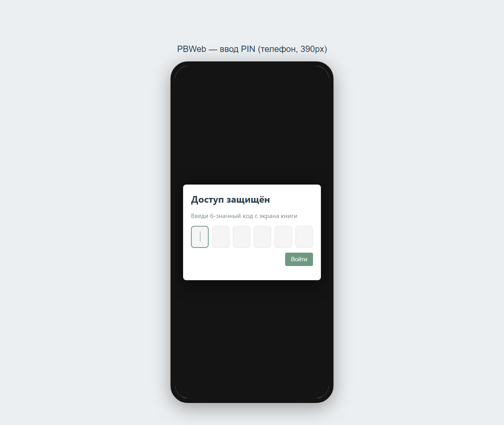
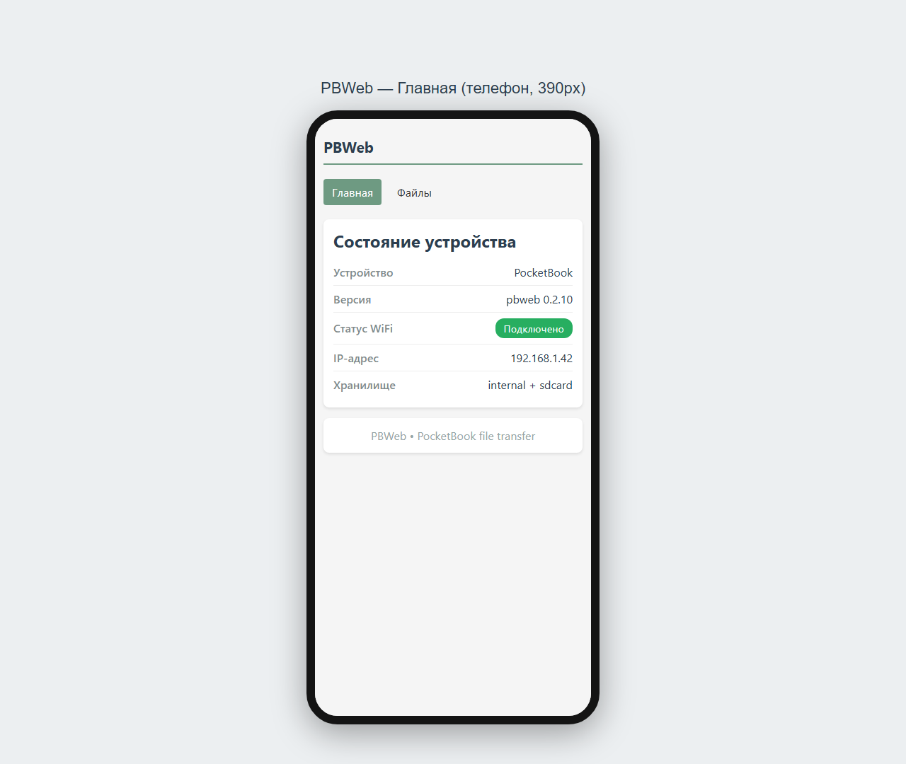
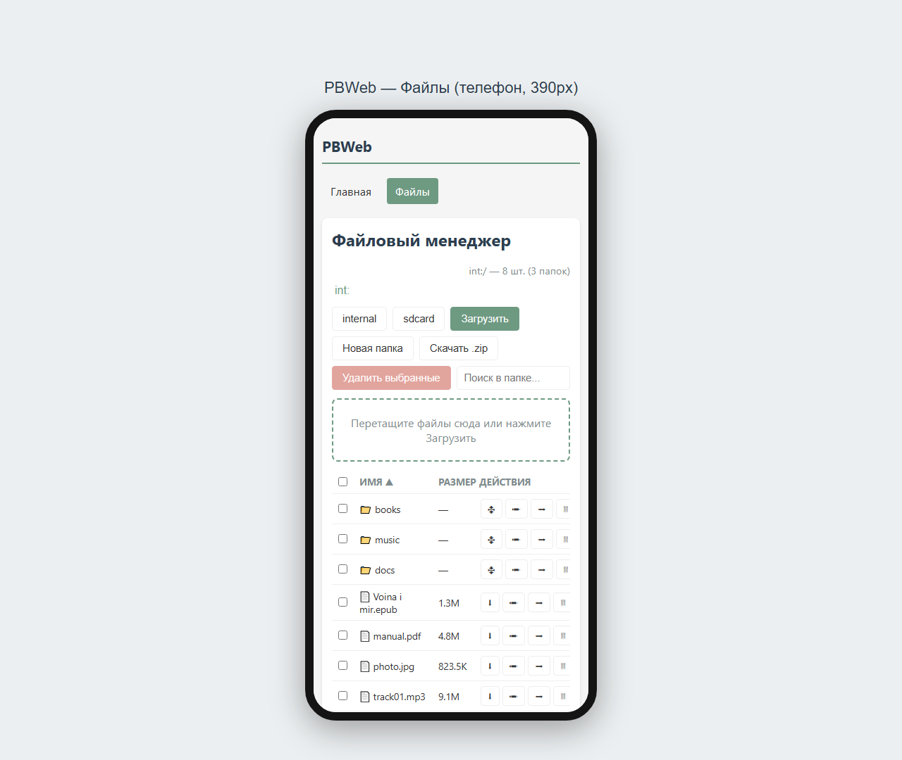
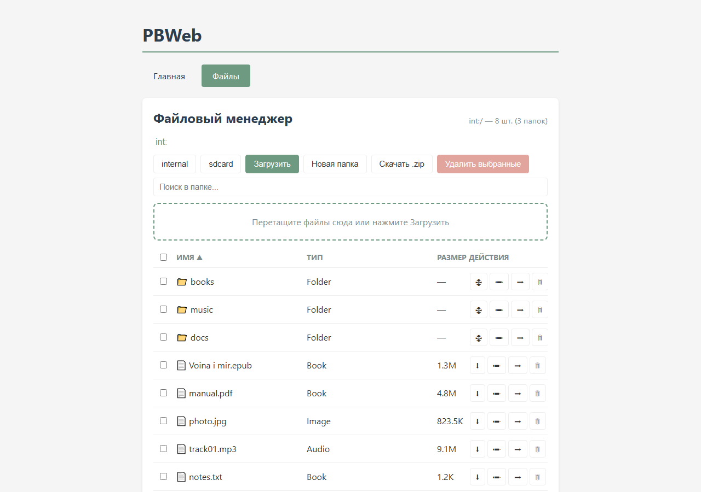
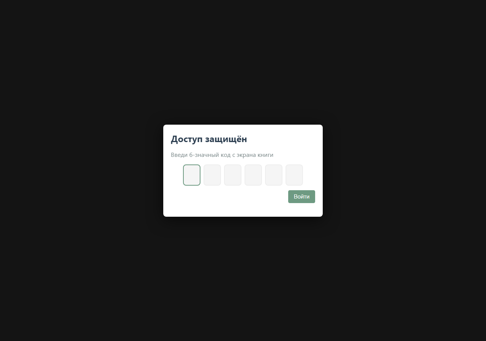
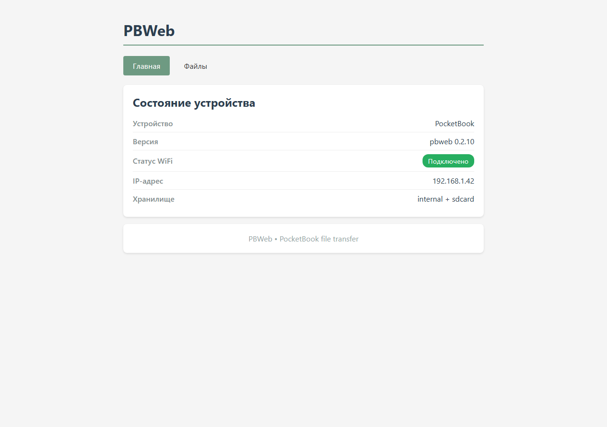
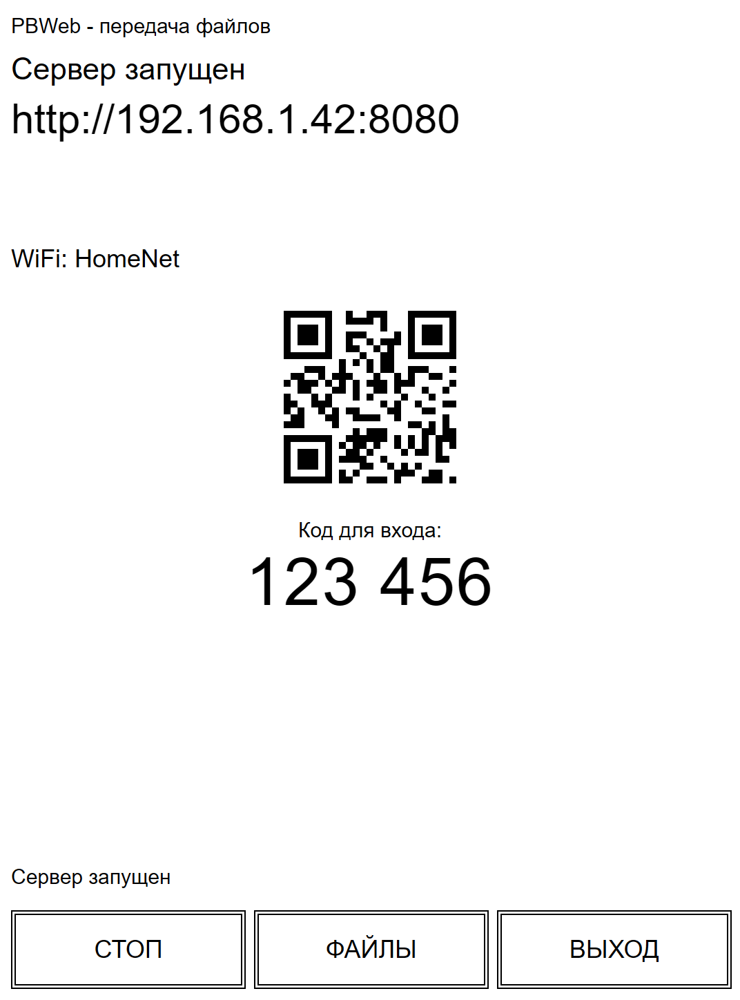
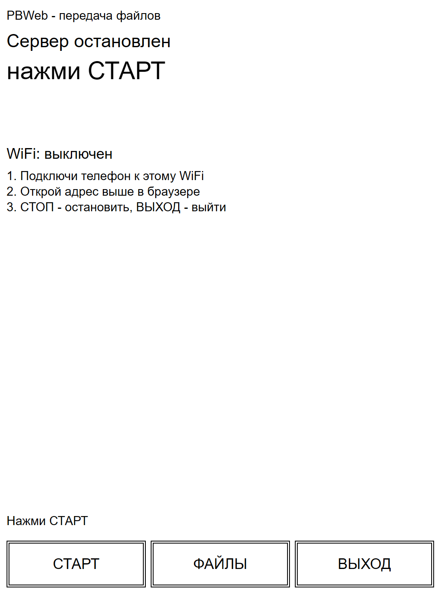
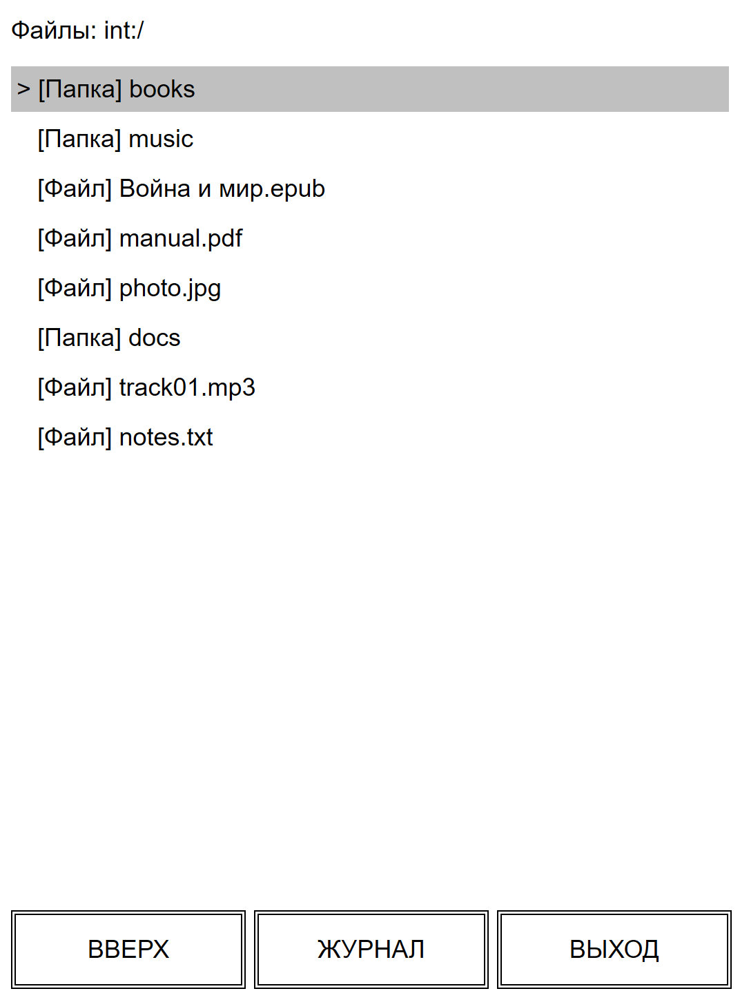
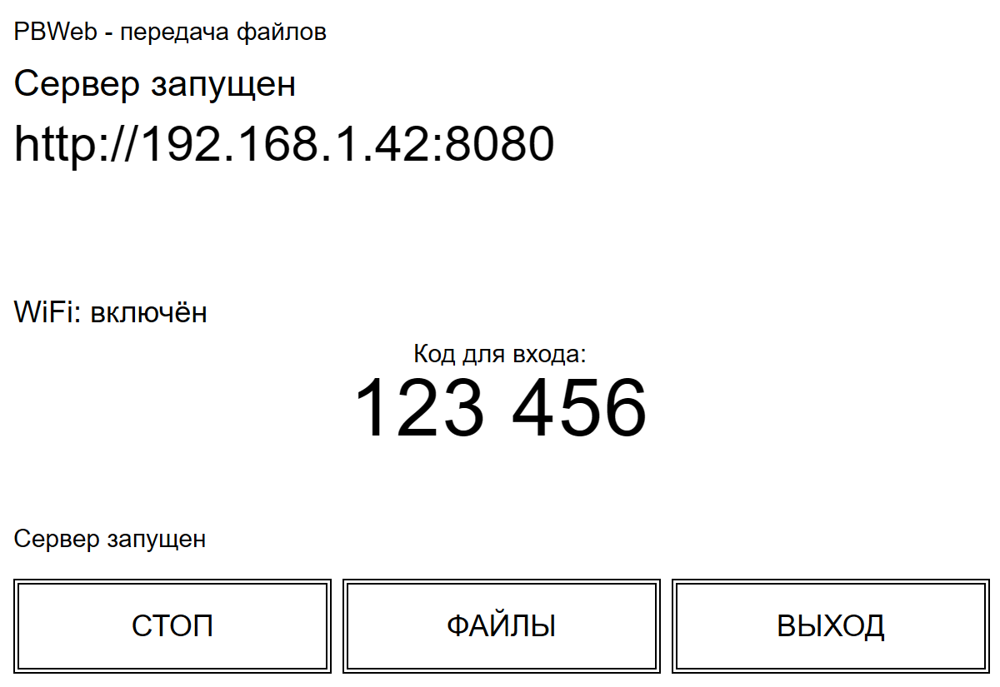

# PBWeb — WiFi file manager for PocketBook

PBWeb is a small app for PocketBook e-readers (PocketBook 633 and Pro 903).
Run it on the reader, and your books and documents become available over your
home Wi-Fi: open on your phone or computer the address shown on the e-ink
screen — and you get a file manager in the browser. Upload new books, download
them back, tidy up folders — no cables needed.

What it does:

- On the reader: tap START (or press MENU), confirm the Wi-Fi prompt, and the
  screen shows a web address, a QR code and a 6-digit PIN.
- On the phone or computer: scan the QR code (or type the address and the PIN)
  and browse the reader's internal storage and SD card from the browser:
  upload books by drag & drop with a progress bar, download, pack a whole
  folder into a ZIP, create/rename/move/delete files and folders
  (multi-select).
- Works on your home Wi-Fi only — the internet is not needed.
- A fresh 6-digit PIN is generated every time you press START and is shown on
  the reader screen; STOP invalidates it. Nothing is stored — no password to
  remember or type.
- New books appear on the reader immediately; the reader's own Library view
  refreshes its metadata (title/author/cover) when you open it.
- STOP stops the sharing without turning Wi-Fi off — press START again any
  time. After you stop, the firmware is asked to update the Library.

## How to use

Install: copy the app and icons to the reader — see
[docs/install.md](docs/install.md).

On the device: open `pbweb.app` → big START button (or MENU key) → "Yes" in
the Wi-Fi prompt → wait for the connection (up to 45 seconds with a countdown)
→ the huge URL + QR code appears (scan it with the phone camera to open the
sharing page, already paired), plus the 6-digit PIN for manual entry, plus
step hints on screen when idle. Everything on the reader's screen is in
Russian; all actions are big touch buttons: START/STOP, middle button named
after the tab it opens (FILES / LOG / STATUS), EXIT; tapping a file row opens it.

While sharing:

- Upload progress is also shown on the reader screen: file name, percent,
  speed (MB/s) and a progress bar; finished uploads stay listed as
  "✓ name (size)" until the next one.
- The Log tab shows recent requests served (handy to see that something
  actually downloaded).
- The server stops by itself after 15 minutes of inactivity.

Button controls (work in all versions, handy without the stylus):

| Key | Status / Log tab | Files tab |
|---|---|---|
| MENU | START/STOP toggle | START/STOP toggle |
| OK | START/STOP toggle | open folder (= tap row) |
| LEFT / RIGHT | switch tab | up / enter |
| UP / DOWN | switch to Files | move selection |
| PREV / NEXT | switch tab | page up / down |
| BACK | EXIT | up; at root → Status; second BACK → EXIT |

In the browser: open the URL shown on the reader (or scan the QR — it already
carries the PIN), then browse, upload by drag & drop, download, zip folders,
rename/move/delete with multi-select.

## Documentation

- [docs/install.md](docs/install.md) — installation on the reader, icons,
  launcher entry, notes & limits, diagnostics.
- [docs/build.md](docs/build.md) — how to build (or where artifact comes from).
- [docs/architecture.md](docs/architecture.md) — implementation details.
- [docs/api.md](docs/api.md) — HTTP API.
- [docs/security.md](docs/security.md) — security model.
- [docs/troubleshooting-903.md](docs/troubleshooting-903.md) — Pro 903 field
  testing.

## Screenshots

Web UI in the phone browser (paired by scanning the QR or typing the 6-digit
PIN from the reader screen):

  

Same UI on desktop:

Reader (e-ink) screens — mockups, not device photos. Sharing state with the
pairing PIN, idle state, Pro 903 landscape, file list:

  

